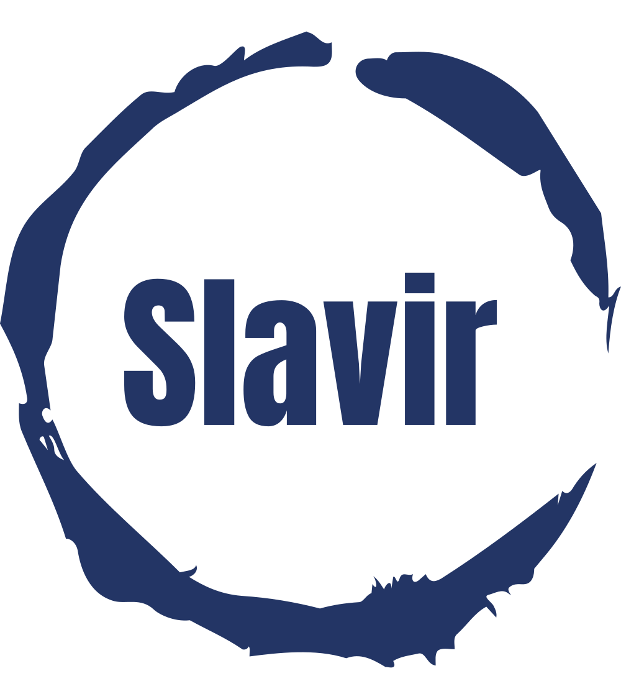

Slavir is an Open-Source Real Time Tactics game inspired by CNC Rivals.

## Project goals:

+ Implement basic mechanics of the game.
+ Single player against bots

## Tech Stack

+ [Phaser 3](https://phaser.io/)
+ [Typescript](https://www.typescriptlang.org/)
+ CSS
+ Webpack
+ [Tiled editor](https://www.mapeditor.org/)
+ Assets - [OpenGameArt](https://opengameart.org/)

Read the [Roadmap](roadmap.md) what's planed (eventually).

## Run locally

Requires Node.js and npm.

```sh
npm ci
npm run dev
```

Open http://localhost:8081. Use `npm run build` to build into `public/`.

## Playing

A three-second countdown precedes each match. Click a building card to unlock its
units, then click unit cards to recruit. Click a friendly unit to select it and
click the map to move, or a visible enemy to attack. Idle combat units attack
eligible enemies in range and follow ordered targets while they remain visible.
Harvesters gather resources automatically. Hold the objective pads to damage the
enemy base with missile strikes.

You can field six units, including at most two harvesters. Recruiting starts a
cooldown of five seconds per fielded unit before the next recruitment; losing a
unit reduces the remaining cooldown by five seconds.

Press Escape or click Pause to freeze the match, including movement, combat,
resource income, countdowns, and pending missile strikes. Resume with Escape or
the Resume button, or return to the menu to start a fresh match. Press F to
dismiss the selected unit. Retire ends the match as a defeat.

The bot recruits harvesters, builds barracks followed by a factory and hangar,
reinforces objective pads, and chooses affordable counters to visible enemies.

## Verification

`npx tsc --noEmit` checks types. `npm test` builds the game and runs gameplay
regressions in a temporary headless browser. The browser tests require Node.js 22
or newer and Chrome, Chromium, or Edge; set `CHROME_PATH` if the executable is not
in one of the detected locations. They cover countdowns, pause/resume, purchases,
production caps, combat, bot decisions, and returning to a fresh match.
