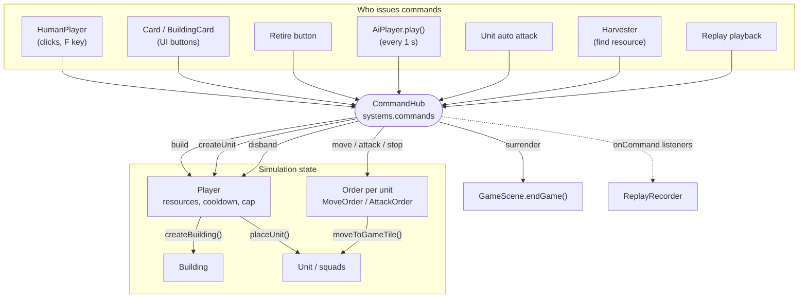
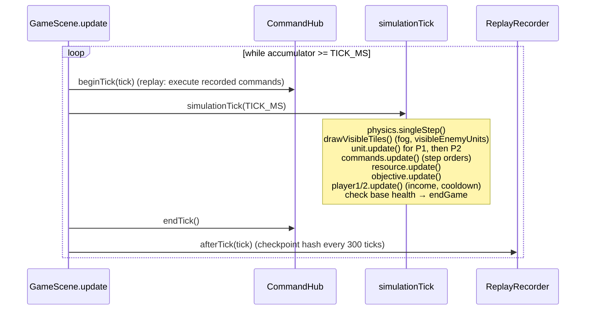
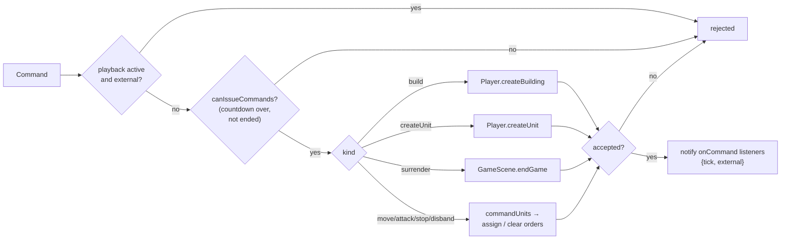
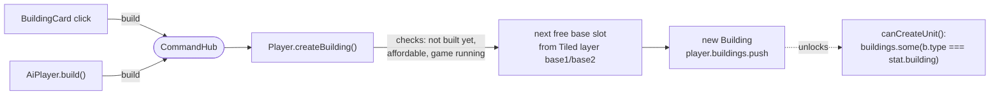
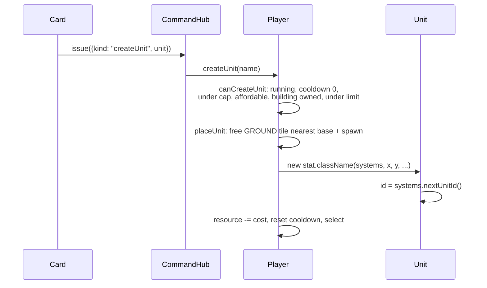

# Game systems architecture

How the pieces of a Slavir match fit together: the scene loop, the `Systems` container, players, buildings,
units, and the `CommandHub` that sits between everything that *wants* something to happen and the simulation
that *makes* it happen.

## The big picture

The rule of thumb: **nothing changes the match except through `systems.commands.issue(...)` or inside a
simulation tick.** Input handlers, the AI, UI cards and even units themselves only *describe* what they want as a
plain `Command`; the hub validates it and applies it.

## Key files

| Area | File | Role |
|---|---|---|
| Scene / loop | [GameScene.ts](../src/scenes/GameScene.ts) | Fixed-tick loop, fog of war, win/lose, HUD |
| Container | [Systems.ts](../src/model/Systems.ts) | Owns map, navigation, players, objective, resources, `commands` |
| Commands | [Command.ts](../src/model/command/Command.ts) | Serializable command types |
| Command hub | [CommandHub.ts](../src/model/command/CommandHub.ts) | Validates commands, runs per-unit orders, notifies listeners |
| Orders | [Order.ts](../src/model/command/Order.ts) | `MoveOrder`, `AttackOrder` – what a unit is doing because of a command |
| Players | [Player.ts](../src/model/player/Player.ts), [HumanPlayer.ts](../src/model/player/HumanPlayer.ts), [AiPlayer.ts](../src/model/player/AiPlayer.ts) | Economy, buildings, unit creation, input / AI |
| Buildings | [Building.ts](../src/entities/Building.ts) | Building types, costs, sprite |
| Units | [Unit.ts](../src/entities/Unit.ts), [UnitsStats.ts](../src/entities/UnitsStats.ts), [UnitRegistry.ts](../src/entities/units/UnitRegistry.ts) | Base unit, stat schema, list of playable units |
| Squads / weapons | [Squad.ts](../src/entities/Squad.ts), [Volley.ts](../src/entities/Volley.ts) | Shared health pool, damage tables, burst fire |
| Movement | [Navigation.ts](../src/model/navigation/Navigation.ts), [Occupancy.ts](../src/model/navigation/Occupancy.ts), [HexMap.ts](../src/model/HexMap.ts) | Pathfinding, body blocking, hex map |
| Objective | [Objective.ts](../src/entities/Objective.ts) | Pads and the missile strike on the enemy base |
| Economy | [Resource.ts](../src/entities/Resource.ts), [Harvester.ts](../src/entities/units/Harvester.ts) | Crystal patches and harvesters |
| Replays | [Replay.ts](../src/model/replay/Replay.ts) | Recorder, verifier, file format |

## `Systems`: the shared container

`GameScene.create()` builds one `Systems` instance per match. Everything else receives `systems` in its
constructor and reaches the rest of the world through it:

- `map` (`HexMap`), `navigation`, `hexes` – the hex grid built from the Tiled map layers
- `player1`, `player2`, `players`, `enemyPlayer(p)`, `allUnits()`
- `objective` (pads + nuke), `resources` (crystal patches, split per player from the map's `player` property)
- `commands` – the `CommandHub`
- `nextUnitId()` – deterministic unit ids (units are created in the same order every run, which replays and a
  future network mode rely on)
- coordinate helpers: `hexToPos`, `pointToTile`, `hexCenter`

The players are created by a factory passed to `Systems` (default: `HumanPlayer` vs `AiPlayer`); the sandbox swaps in
`SandboxHumanPlayer` / `SandboxEnemyPlayer`.

## The simulation tick

`GameScene.update()` does not simulate per rendered frame. It accumulates real time and runs fixed ticks of
`TICK_MS` (1000/60 ms), at most `MAX_TICKS_PER_FRAME` per frame (times the replay speed):

The order inside `simulationTick` matters and is part of the deterministic contract: change it and old replays
desync.

Commands issued **between** ticks (mouse clicks, card clicks) are *external* and take effect on the next tick.
Commands issued **during** a tick (AI, auto attack, harvesters) are *internal* – they are derived from the
simulation state, so a replay reproduces them by itself and does not record them.

## The CommandHub

### Commands

Commands are plain JSON objects (see [Command.ts](../src/model/command/Command.ts)). They reference units by `id`
and tiles by `{col, row}`, never by object, so they can be logged, recorded, or sent over a network.

| Kind | Payload | Effect |
|---|---|---|
| `move` | `unitIds`, `tile` | `MoveOrder` for each unit |
| `attack` | `unitIds`, `targetId` | `AttackOrder` for each unit (target must be a *visible* enemy) |
| `stop` | `unitIds` | Cancel order, stop at the next hex center |
| `disband` | `unitIds` | `player.disband(unit)` (the F key) |
| `build` | `building` | `player.createBuilding(building)` (castle and spawn are not buildable) |
| `createUnit` | `unit` | `player.createUnit(unit)` |
| `surrender` | – | `gameScene.endGame(...)` |

Every command carries `playerIndex`, and the hub only lets a player command its *own* living units.

### `issue(command)`

`issue()` returns `false` when anything fails (not affordable, on cooldown, unit cap, unknown unit, invisible
target…), so callers like the AI and harvesters can simply try again later.

### Orders

The hub keeps one `Order` per unit in a `Map<Unit, Order>`. An order has `start`, `update` and `cancel`:

- `MoveOrder.start` → `unit.moveToGameTile(tile)`; done once the unit stopped and has no nav points left.
- `AttackOrder.start` → `unit.moveToGameTile(null, target)`; done once `unit.target` is no longer that target
  (it died, went out of sight, or the unit gave up).

A new order replaces the old one. `commands.update(delta)` runs once per tick (after units update) and drops
finished orders and orders of dead units. `Player.freeHandler` also calls `commands.forget(unit)` when a unit dies.

### Listeners

`onCommand(listener)` gets every accepted command plus `{tick, external}`. Today the `ReplayRecorder` uses it to
store external commands; it is also the hook for sending local commands to a network peer.

## Players

`Player` is the abstract base shared by human, AI and sandbox players. It owns:

- `units`, `buildings`, `visibleEnemyUnits` (refreshed by the fog of war pass each tick)
- economy: `resource` (starts at 100), passive income of +10 every `harvestTime`, sped up by up to 2 harvesters
- recruiting rules: `maxUnitCount` (10), `createCoolDown` (2.5 s × fielded units), per-unit `limit`
- `base` (castle tile) and `spawn` tile, `currentBaseHealth`

Subclasses only differ in **where commands come from**:

- **`HumanPlayer`** – pointer/keyboard handlers translate clicks into `move` / `attack` / `disband` commands,
  and builds the HUD (unit `Card`s, `BuildingCard`s, resource bar, unit cap). Selection is local UI state, not a
  command.
- **`AiPlayer`** – `play()` runs every 1000 ms of simulation time: keep a harvester, build barracks → factory →
  hangar, pick the best affordable counter (`counterScore`), attack visible threats within vision, otherwise send
  idle units to the least occupied objective pad. All of it goes through `issue()`.
- **`NetworkedAiPlayer`** – the network game's player 2: sends a fog-limited observation to a remote bot every
  second and issues the commands it answers with as external input. See [networkgame.md](networkgame.md).

## Buildings

Buildings are simple: a sprite plus a `BuildingStat` (`type`, `cost`, texture). They have no update loop and no
health of their own (base damage is tracked on the player). Their job is to **gate unit production**:

- `CASTLE` and `SPAWN` are placed for free by `Player.create()` at match start; they define `player.base` and
  `player.spawn`. New units appear on the free ground tile closest to both.
- `BARRACK` (30), `FACTORY` (60), `HANGAR` (50), `TECH` (100) are bought. Each goes into the next numbered slot
  of the player's base object layer.
- Every `UnitStat` has a `building` field; a unit can only be recruited if the player owns that building type.
- Enemy buildings start hidden and are revealed the first time player 1 sees their tile.
- `BuildingCard` removes itself when the building appears in `player.buildings` (it reacts to state, not to the
  click, so it also works when the command lands a tick later).

## Units

### Creation

Each unit class (e.g. [Titan.ts](../src/entities/units/Titan.ts)) declares a static `stat: UnitStat`, and
[UnitRegistry.ts](../src/entities/units/UnitRegistry.ts) lists them in card order. `UnitStat` holds everything
data-driven: cost, building, health, squad size, damage per target type, range, vision, speed, `flying`,
`volley`, `squadFire`, `fireOnMove`, `initialChargeUp`, …

### Per-tick behaviour (`Unit.update`)

1. Dead units only play their death and remove themselves.
2. Claim the hex the unit stepped into (body blocking via `Occupancy`); bounce back from enemy-held hexes.
3. Drop the target if it is dead / invisible / unattackable; stop chasing a target that left range after engaging.
4. **Auto attack:** an idle, stationary combat unit with a visible enemy in range issues an `attack` command
   *for itself* through the hub, so the hub's order bookkeeping stays the single source of truth.
5. Trim the path when the target is already in range, repath if blocked, pick a fire target.
6. Move toward the next nav point (arcade physics), snap to hex centers on arrival.
7. Advance weapons (`Volley`) and fire; damage is applied with `target.takeDamage(this, shooters)`.

### Squads and damage

A unit with `squadSize > 1` is one game object with follower sprites. It has a shared health pool
(`health × squadSize`); members die as the pool crosses multiples of `health`, and fewer living members means fewer
shots. Damage per member is picked from the attacker's `damageAgainstInfantry / Vehicle / Air` by the target's `type`.

### Movement rules (Occupancy)

- Ground and flying units live on separate layers and never block each other while moving.
- Enemies on the same layer can't enter each other's hex; friendlies walk through.
- No two units ever *stand* on the same hex, whatever their side or layer.

### Death

`Unit.free` → `Player.freeHandler`: refund 2.5 s of recruit cooldown; if it was a destroyed harvester, reward
the enemy +80 (whoever destroyed it, the owner's own ion cannon included) and give the owner one free rebuild
(`freeHarvesters`); deselect, `commands.forget(unit)`, then remove from `player.units` once the death animation ends.

## Economy, harvesters and resources

- Each player has crystal `Resource` patches from the map. A `Harvester` sends itself to the nearest free patch
  with a `move` command, then sets `resource.occupied` and calls `player.increaseHarvesterCount()`.
- The number of harvesting harvesters (max 2) speeds up `Player.update`'s passive income.
- `Player.unitCost(name)` is what recruiting costs right now: 0 for a harvester while `freeHarvesters > 0`, the
  stat's `cost` otherwise. Recruiting, the cards and both bots use it; a dismissed harvester (F, a debug key)
  gives no bounty and no free rebuild.
- A patch depletes after 100 s of active harvesting and removes itself from `systems.resources` and both players.

## Objective (pads and nuke in the middle of the map)

The `Objective` owns the three pads and the nuke obelisk in the center:

- Each tick it checks which player has a living unit on each pad (`pads[i] = p1 − p2`).
- While the sum is non-zero the charge (`currentCoolDown`) fills to 60 s; when full a strike launches at the
  losing side and lands 3 s later: `player.takeObjectiveDamage()` removes half of the base health.
- After a strike there is a 10 s peace period. With nobody ahead the charge decays back to 55 s at most.
- Base health ≤ 0 → `GameScene.endGame`.

The objective doesn't know about commands; units affect it only by standing on pads, which they get to via
`move` commands (from the player, or the AI's pad logic).

## Fog of war

`GameScene.calculateVisibleTilesForPlayer` runs for both players at the start of every tick: tiles within each
unit's `visionRadius` plus radius 3 around the castle. It fills `player.visibleEnemyUnits`, which is the single
visibility check used by attack commands, auto attack, AI decisions and target dropping.

## Replays

Because the simulation is fixed-tick and every change goes through the hub, a replay is just:

- the **external** commands with the tick they took effect on (`ReplayRecorder` via `onCommand`),
- a state hash every 300 ticks (`stateHash`: resources, base health, cooldowns, unit ids/positions/health,
  objective charge).

Playback starts a fresh match, calls `commands.startPlayback(entries)`, and `beginTick` feeds the recorded
commands back; live input is rejected. `ReplayVerifier` compares hashes and reports the first desync tick.

## Rules when adding things

- **New player action?** Add a `Command` kind, handle it in `CommandHub.issue`, and issue it from the UI / AI.
  Don't mutate players or units from input handlers.
- **New unit?** Create a class with a static `stat`, add it to `unitClasses` in `UnitRegistry.ts`, and set its
  `building`.
- **New building?** Add it to the `Buildings` enum and `buildingStat`, and to `hasBuildings` plus a base slot on the map.
- **Anything that affects the outcome** must run inside `simulationTick` using its fixed `delta` (not the scene
  clock, tweens or `Math.random`), or replays will desync. Visuals may do whatever they want.
- **Changing tick order or rules** invalidates existing replays (bump `REPLAY_VERSION` if the format changes).
