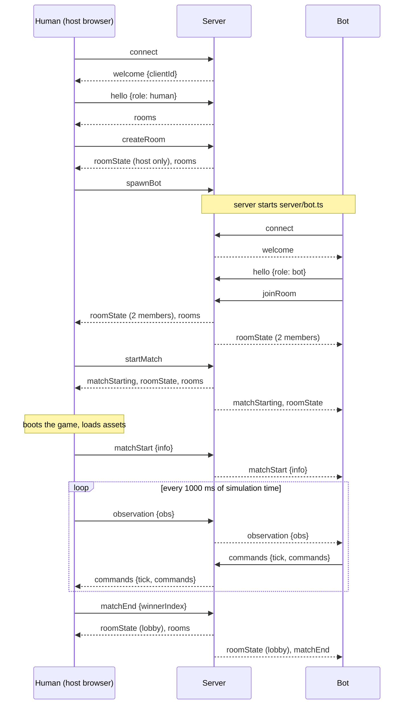

# Network protocol reference

Everything a client needs to talk to the network game server: every message with an example payload, what the
server does with it, and what a client has to do when the server sends something. For how the pieces fit together
and how to run them, see [networkgame.md](networkgame.md).

The TypeScript types are the source of truth: [`protocol.ts`](../src/net/protocol.ts) (messages),
[`Observation.ts`](../src/net/Observation.ts) (match info, observations, wire commands) and
[`Command.ts`](../src/model/command/Command.ts) (commands). Every JSON example on this page is checked against
them; the `<!-- type: … -->` marker before an example (visible in the Markdown source) names its type.

- [Transport](#transport)
- [Roles and rooms](#roles-and-rooms)
- [A whole session](#a-whole-session)
- [Client → server messages](#client--server-messages)
- [Server → client messages](#server--client-messages)
- [Match messages (relayed)](#match-messages-relayed)
- [Commands](#commands)
- [MatchInfo fields](#matchinfo-fields)
- [Observation fields](#observation-fields)
- [Writing a bot: checklist](#writing-a-bot-checklist)

## Transport

|                  |                                                                                                                                                                                                                                                                                    |
| ---------------- | ---------------------------------------------------------------------------------------------------------------------------------------------------------------------------------------------------------------------------------------------------------------------------------- |
| URL              | `ws://localhost:8090` (`npm run server`, `PORT=…` to change). The lobby page connects to `ws(s)://<page host>/ws`, which the Vite dev / preview server proxies to it.                                                                                                              |
| Frames           | Text frames, one JSON object per frame. Binary frames are not used.                                                                                                                                                                                                                |
| Shape            | Every message has a string `type`; the other fields depend on it.                                                                                                                                                                                                                  |
| Version          | `NET_PROTOCOL_VERSION = 1`, sent in `hello`. A different version is refused.                                                                                                                                                                                                       |
| Unknown types    | Ignored without an answer.                                                                                                                                                                                                                                                         |
| Invalid JSON     | Answered with `error` `"Not JSON"`.                                                                                                                                                                                                                                                |
| Acknowledgements | There are none. A request either changes state (and you get the resulting `roomState` / `rooms`) or fails with an `error`, or it is silently ignored when it makes no sense from your role (listed per message below). Commands are never acknowledged; see [Commands](#commands). |

## Roles and rooms

A client says what it is in `hello`:

- **`human`**: the player in the browser. The human who creates a room is its **host**: the host's browser runs the
  whole simulation and sends the bot what it may see.
- **`bot`**: a networked AI. It only joins rooms and plays.

A room holds at most one human and one bot. Its `state` is `"lobby"` or `"playing"`.

| Event                      | Effect                                                                                                                       |
| -------------------------- | ---------------------------------------------------------------------------------------------------------------------------- |
| Host leaves or disconnects | The room closes: every member gets `roomState` with `room: null`, and a bot process the server started for it is killed.     |
| Bot leaves or disconnects  | The host gets `peerLeft` and a new `roomState`; the room stays open for another bot. A running match goes on without the AI. |
| Host sends `matchEnd`      | The room goes back to `"lobby"`; the same bot can play a rematch.                                                            |

## A whole session



## Client → server messages

### `hello`

The first message after connecting; the server answers anything else sent before it with `error`
`"Say hello first"`. It may be sent again later to change the name; the role is taken from the latest one.

<!-- type: ClientMessage -->
```json
{ "type": "hello", "role": "human", "name": "Imre", "protocol": 1 }
```

<!-- type: ClientMessage -->
```json
{ "type": "hello", "role": "bot", "name": "Networked AI", "protocol": 1 }
```

| Field      |                                                                                 |
| ---------- | ------------------------------------------------------------------------------- |
| `role`     | `"human"` or `"bot"`; anything else counts as `"human"`                         |
| `name`     | Shown in the lobby, cut to 32 characters. Empty: `"Player"` / `"Networked AI"`. |
| `protocol` | Must be `1`                                                                     |

Server: a human gets `rooms` right away. A wrong `protocol` gets an `error` and the connection is closed.

### `listRooms`

<!-- type: ClientMessage -->
```json
{ "type": "listRooms" }
```

Server: answers with `rooms`. Humans also get `rooms` on their own whenever any room changes, so this is only
needed to refresh, e.g. after coming back from a match.

### `createRoom`

Human only (ignored from a bot). Leaves the sender's current room first.

<!-- type: ClientMessage -->
```json
{ "type": "createRoom", "name": "Friday night" }
```

| Field  |                                                 |
| ------ | ----------------------------------------------- |
| `name` | Cut to 40 characters. Empty: `"<name>'s room"`. |

Server: creates the room with the sender as host, sends the sender `roomState`, and every human `rooms`. Room ids
are short strings counting up from `"1"`.

### `joinRoom`

Humans join a room as its human, bots as its bot. Leaves the sender's current room first; joining the room the
sender is already in does nothing.

<!-- type: ClientMessage -->
```json
{ "type": "joinRoom", "roomId": "1" }
```

Server: on success every member gets `roomState`, every human gets `rooms`. Errors: `"No such room"`,
`"The room already has a human"` / `"The room already has a bot"`, `"The match already started"` (human
joining a room in `"playing"`).

A bot may join a room that is already `"playing"` (to replace an AI that dropped out), but it only receives
observations from then on, never the `matchStart` of that match, so it has no `MatchInfo` to work with. The
bundled bot ignores observations until it has one.

### `leaveRoom`

<!-- type: ClientMessage -->
```json
{ "type": "leaveRoom" }
```

Server: the sender gets `roomState` with `room: null`. If the sender was the host the room closes (see
[Roles and rooms](#roles-and-rooms)), otherwise the others get `peerLeft` and `roomState`. Ignored outside a
room.

### `spawnBot`

Host only: asks the server to start a bot process (`node --import tsx server/bot.ts --room <id> --url …`) that
joins the sender's room. Ignored from anyone who is not the host of a room.

<!-- type: ClientMessage -->
```json
{ "type": "spawnBot" }
```

Server: starts the process. When it has connected and joined, the room's members get `roomState` with the bot in
it. Error: `"The room already has an AI"` when a bot is in the room or a started bot process is still running.

### `startMatch`

Host only (ignored from anyone else).

<!-- type: ClientMessage -->
```json
{ "type": "startMatch" }
```

Server: sets the room to `"playing"`, sends every member `matchStarting`, then `roomState`, and every human
`rooms`. Error: `"Add a networked AI first"` when there is no bot in the room.

The match messages (`matchStart`, `observation`, `commands`, `matchEnd`) are also sent by clients; they are
described under [Match messages](#match-messages-relayed).

## Server → client messages

For each message: an example, then what a client has to do with it.

### `welcome`

Sent right after connecting, before `hello`.

<!-- type: ServerMessage -->
```json
{ "type": "welcome", "clientId": "3b0f2c7e-8f43-4f4b-9d0e-5f0a2c51a6d1" }
```

**Process:** keep `clientId`. A human needs it to tell whether it is the host of its room
(`room.hostId === clientId`), which decides whether to show "Add AI" and "Start match".

### `rooms`

Only sent to humans: after `hello`, on `listRooms`, and whenever a room is created, changes or closes.

<!-- type: ServerMessage -->
```json
{
    "type": "rooms",
    "rooms": [
        {
            "id": "1",
            "name": "Friday night",
            "hostId": "3b0f2c7e-8f43-4f4b-9d0e-5f0a2c51a6d1",
            "members": [{ "id": "3b0f2c7e-8f43-4f4b-9d0e-5f0a2c51a6d1", "name": "Imre", "role": "human" }],
            "state": "lobby"
        }
    ]
}
```

**Process:** replace the whole list (it is always complete). A room can be joined by a human when it has no human
member and its `state` is `"lobby"`.

### `roomState`

The room the receiver is in, sent to every member whenever it changes (someone joined or left, match started or
ended). `room: null` means the receiver is in no room any more: it left, or the room closed because the host
left.

<!-- type: ServerMessage -->
```json
{
    "type": "roomState",
    "room": {
        "id": "1",
        "name": "Friday night",
        "hostId": "3b0f2c7e-8f43-4f4b-9d0e-5f0a2c51a6d1",
        "members": [
            { "id": "3b0f2c7e-8f43-4f4b-9d0e-5f0a2c51a6d1", "name": "Imre", "role": "human" },
            { "id": "a91d3e55-0c1f-4b67-8a2e-77d3f9e01b42", "name": "Networked AI", "role": "bot" }
        ],
        "state": "lobby"
    }
}
```

<!-- type: ServerMessage -->
```json
{ "type": "roomState", "room": null }
```

**Process (human):** show the room; the AI slot is filled when a member has `role: "bot"`; enable "Start match"
for the host when it is. `null`: go back to the room list.

**Process (bot):** the first non-null `roomState` confirms the join. A later `null` means the room closed: there
is nothing left to play, so disconnect (the bundled bot exits).

### `matchStarting`

Sent to every member when the host started the match.

<!-- type: ServerMessage -->
```json
{
    "type": "matchStarting",
    "room": {
        "id": "1",
        "name": "Friday night",
        "hostId": "3b0f2c7e-8f43-4f4b-9d0e-5f0a2c51a6d1",
        "members": [
            { "id": "3b0f2c7e-8f43-4f4b-9d0e-5f0a2c51a6d1", "name": "Imre", "role": "human" },
            { "id": "a91d3e55-0c1f-4b67-8a2e-77d3f9e01b42", "name": "Networked AI", "role": "bot" }
        ],
        "state": "playing"
    }
}
```

**Process (host):** start the game. Once the simulation is set up (both players created), send `matchStart`
exactly once, then observations.

**Process (bot):** nothing to do yet; wait for `matchStart`, which comes a few seconds later, after the host's
browser has loaded the game.

### `peerLeft`

Sent to the members who stay when another member leaves or disconnects (not when the host leaves: then the room
closes and everyone gets `roomState` `null`).

<!-- type: ServerMessage -->
```json
{ "type": "peerLeft", "member": { "id": "a91d3e55-0c1f-4b67-8a2e-77d3f9e01b42", "name": "Networked AI", "role": "bot" } }
```

**Process (host):** if `member.role` is `"bot"` during a match, the AI is gone: keep simulating (its units stay
and still auto attack, but get no new orders) and tell the player ("Networked AI disconnected"). In the lobby,
the AI slot is empty again and another bot can be added.

### `error`

A request failed and nothing changed.

<!-- type: ServerMessage -->
```json
{ "type": "error", "message": "The room already has a bot" }
```

**Process:** show or log it, and undo any optimistic UI (e.g. a "Starting AI…" button). All messages the server
sends:

| `message`                                            | Cause                                                                  |
| ---------------------------------------------------- | ---------------------------------------------------------------------- |
| `Say hello first`                                    | Any message before `hello`                                             |
| `Protocol <n> is not supported, the server speaks 1` | Wrong `protocol` in `hello`; the server closes the connection after it |
| `Not JSON`                                           | The frame did not parse                                                |
| `No such room`                                       | `joinRoom` with an unknown id                                          |
| `The room already has a human` / `… a bot`           | `joinRoom` into a taken slot                                           |
| `The match already started`                          | Human `joinRoom` into a `"playing"` room                               |
| `The room already has an AI`                         | `spawnBot` with a bot present or still starting                        |
| `Add a networked AI first`                           | `startMatch` without a bot                                             |

The relayed match messages below also arrive from the server; they are forwarded unchanged from the other member
of the room.

## Match messages (relayed)

The server forwards these between the two members of a room, unchanged, but only from the role allowed to send
them; from anyone else (or outside a room) they are dropped without an answer.

| Message       | Sender       | Receiver     |
| ------------- | ------------ | ------------ |
| `matchStart`  | human (host) | bot          |
| `observation` | human (host) | bot          |
| `commands`    | bot          | human (host) |
| `matchEnd`    | human (host) | bot          |

### `matchStart`

Once per match, from the host when its simulation is ready. `info` is the [`MatchInfo`](#matchinfo-fields): the
static facts of the match. This example is shortened (a real one lists every tile, unit and building).

<!-- type: RelayMessage -->
```json
{
    "type": "matchStart",
    "info": {
        "playerIndex": 2,
        "enemyIndex": 1,
        "tickMs": 16.666666666666668,
        "observationIntervalMs": 1000,
        "tiles": [{ "col": 3, "row": 4, "q": 1, "r": 4, "ground": true }, { "col": 4, "row": 4, "q": 2, "r": 4, "ground": false }],
        "pads": [[{ "col": 7, "row": 2 }, { "col": 8, "row": 2 }], [{ "col": 7, "row": 5 }], [{ "col": 7, "row": 8 }]],
        "nuke": { "col": 7, "row": 4 },
        "base": { "col": 13, "row": 4 },
        "spawn": { "col": 12, "row": 5 },
        "enemyBase": { "col": 1, "row": 4 },
        "units": [
            {
                "name": "fantasy8",
                "cost": 10,
                "building": "barrack",
                "type": "infantry",
                "canAttack": true,
                "canAttackAir": false,
                "goodAgainstInfantry": true,
                "goodAgainstFactory": false,
                "goodAgainstAir": false,
                "visionRadius": 3,
                "attackRange": 1,
                "flying": false,
                "limit": -1,
                "maxHealth": 650,
                "harvester": false
            }
        ],
        "buildings": [
            { "type": "barrack", "cost": 30 },
            { "type": "factory", "cost": 60 },
            { "type": "hangar", "cost": 50 },
            { "type": "tech", "cost": 100 }
        ],
        "powers": [{ "name": "turret", "cost": 40, "coolDown": 30000 }, { "name": "ionCannon", "cost": 130, "coolDown": 30000 }],
        "maxUnitCount": 10
    }
}
```

**Process (bot):** throw away anything from a previous match and keep `info`. Useful to precompute: a lookup from
`"col,row"` to the tile (for `q` / `r` and `ground`) and from unit name to its catalog entry.

### `observation`

From the host every `info.observationIntervalMs` (1000) ms of **simulation** time, while commands are accepted
(not during the start countdown, not after the end, and not while the host has the game paused). `obs` is the
[`Observation`](#observation-fields): what the bot's player may know right now.

<!-- type: RelayMessage -->
```json
{
    "type": "observation",
    "obs": {
        "tick": 1830,
        "timeMs": 30500,
        "canIssueCommands": true,
        "self": {
            "resource": 85,
            "baseHealth": 30000,
            "maxBaseHealth": 30000,
            "createCoolDown": 0,
            "armySize": 3,
            "maxUnitCount": 10,
            "buildings": ["castle", "spawn", "barrack"],
            "canCreate": ["fantasy8", "female_archer"],
            "unitCosts": { "fantasy8": 10, "female_archer": 20, "male_engineer": 0 },
            "freeHarvesters": 1,
            "resources": [{ "tile": { "col": 12, "row": 1 }, "occupied": true }, { "tile": { "col": 12, "row": 7 }, "occupied": false }],
            "powers": [{ "name": "turret", "ready": true, "coolDown": 0 }, { "name": "ionCannon", "ready": false, "coolDown": 12000 }],
            "turretTiles": [{ "col": 9, "row": 4 }, { "col": 10, "row": 3 }]
        },
        "units": [
            {
                "id": 2,
                "name": "male_engineer",
                "tile": { "col": 12, "row": 1 },
                "health": 3400,
                "maxHealth": 3400,
                "moving": false,
                "parked": true,
                "immobile": false,
                "targetId": null,
                "destination": null,
                "givenUpOn": []
            },
            {
                "id": 5,
                "name": "fantasy8",
                "tile": { "col": 9, "row": 3 },
                "health": 520,
                "maxHealth": 650,
                "moving": true,
                "parked": false,
                "immobile": false,
                "targetId": null,
                "destination": { "col": 8, "row": 3 },
                "givenUpOn": []
            }
        ],
        "visibleTiles": [{ "col": 9, "row": 3 }, { "col": 8, "row": 3 }, { "col": 7, "row": 3 }],
        "enemy": {
            "baseHealth": 30000,
            "maxBaseHealth": 30000,
            "units": [
                {
                    "id": 6,
                    "name": "fantasy8",
                    "type": "infantry",
                    "tile": { "col": 7, "row": 3 },
                    "health": 650,
                    "maxHealth": 650,
                    "moving": false,
                    "parked": true,
                    "harvester": false
                }
            ],
            "buildings": [{ "type": "spawn", "tile": { "col": 2, "row": 5 } }]
        },
        "objective": { "pads": [0, -1, 1], "charge": 4200, "maxCharge": 60000, "peace": 0 }
    }
}
```

**Process (bot):**

1. Ignore it if you have no `MatchInfo` yet, or if `canIssueCommands` is false.
2. Decide on this observation only. It is a complete snapshot, not a diff; nothing carries over from the last one
   except what you remember yourself.
3. Answer with one `commands` message whose `tick` is `obs.tick`. Sending nothing is fine when there is nothing to
   do.
4. Answer quickly: batches for an observation more than 180 ticks (3 s of simulation) old are dropped by the host.
5. Don't assume earlier commands worked. Commands are not acknowledged; the next observation shows what happened
   (e.g. a unit that was ordered to move has `moving: true` or a new `destination`).

### `commands`

From the bot, the answer to one observation: a list of [commands](#commands), carried out in order.

<!-- type: RelayMessage -->
```json
{
    "type": "commands",
    "tick": 1830,
    "commands": [
        { "kind": "createUnit", "playerIndex": 2, "unit": "fantasy8" },
        { "kind": "attack", "playerIndex": 2, "unitIds": [5], "targetId": 6 },
        { "kind": "power", "playerIndex": 2, "power": "turret", "tile": { "col": 9, "row": 4 } }
    ]
}
```

**Process (host):** drop the batch if the match has ended, if `commands` is not an array or `tick` not a number,
or if `tick` is more than 180 ticks behind the current tick. Otherwise, for each command with a known `kind`:
replace `playerIndex` with the networked player's index (a bot can never command the human's units) and issue it
through the `CommandHub`, which validates it like any player's input. A rejected command is skipped; the rest of
the batch still runs. The commands take effect on the next simulation tick and are recorded in the replay.

### `matchEnd`

From the host when the match is over. `winnerIndex` is the winning player's index, or `null` when the host left
the match unfinished (pause menu → return to menu, closing the game).

<!-- type: RelayMessage -->
```json
{ "type": "matchEnd", "winnerIndex": 1 }
```

<!-- type: RelayMessage -->
```json
{ "type": "matchEnd", "winnerIndex": null }
```

**Process (bot):** stop deciding and drop the `MatchInfo`; observations stop too. Stay connected: the room is back
in `"lobby"` and the host may start a rematch, which begins with a new `matchStarting` and `matchStart`.

The server also sets the room back to `"lobby"` and sends everyone `roomState` before forwarding this message.

## Commands

The `commands` of a `commands` message. They are plain JSON: units are referenced by `id`, tiles by tilemap
coordinates `{col, row}` (the same `col` / `row` as in `MatchInfo.tiles`), and unit, building and power names by
their string values. `playerIndex` is required by the type but the host overwrites it anyway; send your own
`info.playerIndex`.

Every command is rejected while the match does not accept commands (start countdown, after the end). There is no
feedback; check the next observation.

### `move`

Walk to a tile. A new order replaces the unit's current one.

<!-- type: WireCommand -->
```json
{ "kind": "move", "playerIndex": 2, "unitIds": [5, 7], "tile": { "col": 7, "row": 5 } }
```

Rejected when none of `unitIds` is an own, living, mobile unit (unknown ids, dead units and turrets are skipped),
or the tile is not on the map. The unit finds its own path; flying units can cross any tile, ground units only
`ground` ones.

### `attack`

Chase and attack an enemy unit.

<!-- type: WireCommand -->
```json
{ "kind": "attack", "playerIndex": 2, "unitIds": [5], "targetId": 6 }
```

Rejected unless `targetId` is in `obs.enemy.units` **right now** (visible to your player). Units that cannot hit
the target (an air unit for a unit without `canAttackAir`) do not attack it. A unit whose `givenUpOn` lists the
target found no free hex to attack it from; ordering the attack again will fail the same way for a while. The
order ends when the target dies or goes out of sight.

### `stop`

Drop the units' orders; they stop on the next hex center.

<!-- type: WireCommand -->
```json
{ "kind": "stop", "playerIndex": 2, "unitIds": [5] }
```

### `disband`

Remove own units from the game (the human's F key). Frees their place under the unit cap.

<!-- type: WireCommand -->
```json
{ "kind": "disband", "playerIndex": 2, "unitIds": [7] }
```

### `build`

Construct a building in the next free slot of your base.

<!-- type: WireCommand -->
```json
{ "kind": "build", "playerIndex": 2, "building": "factory" }
```

`building` is one of `info.buildings`: `"barrack"`, `"factory"`, `"hangar"`, `"tech"`. Rejected for
`"castle"` / `"spawn"` (placed at the start), a building you already have (`self.buildings`), or when
`self.resource` is below its cost.

### `createUnit`

Recruit a unit next to your base.

<!-- type: WireCommand -->
```json
{ "kind": "createUnit", "playerIndex": 2, "unit": "female_archer" }
```

`unit` is a `name` from `info.units`. Accepted when it is in `self.canCreate`, which already checks everything:
recruit cooldown over (`self.createCoolDown` 0), under the cap (`self.armySize < self.maxUnitCount`), affordable
(`self.unitCosts`, where a destroyed harvester is rebuilt for free), the unit's building owned, and its `limit`
not reached. Recruiting sets a new cooldown, so at most one unit per batch gets through.

### `power`

Use a commander power on a tile.

<!-- type: WireCommand -->
```json
{ "kind": "power", "playerIndex": 2, "power": "ionCannon", "tile": { "col": 7, "row": 3 } }
```

<!-- type: WireCommand -->
```json
{ "kind": "power", "playerIndex": 2, "power": "turret", "tile": { "col": 9, "row": 4 } }
```

Needs the power `ready` in `self.powers` (off cooldown and affordable). The tile must be visible
(`obs.visibleTiles`); for the turret it must also be one of `self.turretTiles` (free ground, no pad, no building,
not too far forward). The ion cannon blasts its tile and the hexes around it after 3.3 s, so moving targets often
escape; it also hurts your own units in the blast.

### `surrender`

Give up the match; your player loses.

<!-- type: WireCommand -->
```json
{ "kind": "surrender", "playerIndex": 2 }
```

## MatchInfo fields

| Field                       |                                                                                                                                                                                                                                                                                                                                    |
| --------------------------- | ---------------------------------------------------------------------------------------------------------------------------------------------------------------------------------------------------------------------------------------------------------------------------------------------------------------------------------- |
| `playerIndex`, `enemyIndex` | Your player's index (2) and the human's (1)                                                                                                                                                                                                                                                                                        |
| `tickMs`                    | Length of one simulation tick, 1000/60 ms                                                                                                                                                                                                                                                                                          |
| `observationIntervalMs`     | Simulation ms between observations (1000)                                                                                                                                                                                                                                                                                          |
| `tiles[]`                   | Every map tile: `col`, `row` (what commands use), cube coordinates `q`, `r`, and `ground` (ground units can stand there)                                                                                                                                                                                                           |
| `pads`                      | The three objective pads, each a list of tiles; holding more of a pad than the enemy charges the nuke against them                                                                                                                                                                                                                 |
| `nuke`                      | The obelisk tile in the middle                                                                                                                                                                                                                                                                                                     |
| `base`, `spawn`             | Your castle and spawn tiles; units are recruited next to them                                                                                                                                                                                                                                                                      |
| `enemyBase`                 | The enemy castle tile (the map is public)                                                                                                                                                                                                                                                                                          |
| `units[]`                   | Unit catalog: `name`, full `cost`, required `building`, `type` (`infantry`, `vehicle`, `aircraft`, `structure`), `canAttack`, `canAttackAir`, `goodAgainstInfantry` / `Factory` (vehicles and structures) / `Air`, `visionRadius` and `attackRange` in hexes, `flying`, `limit` (-1: none), `maxHealth` (whole squad), `harvester` |
| `buildings[]`               | Buildable buildings and their cost                                                                                                                                                                                                                                                                                                 |
| `powers[]`                  | Commander powers: `name`, `cost`, `coolDown` in ms                                                                                                                                                                                                                                                                                 |
| `maxUnitCount`              | Unit cap                                                                                                                                                                                                                                                                                                                           |

Hex distance between two tiles: `(|q1 − q2| + |r1 − r2| + |q1 + r1 − q2 − r2|) / 2`, exported as `hexDistance` from
[`Observation.ts`](../src/net/Observation.ts).

## Observation fields

| Field                               |                                                                                                                                                                             |
| ----------------------------------- | --------------------------------------------------------------------------------------------------------------------------------------------------------------------------- |
| `tick`                              | Simulation tick it was taken on; echo it in `commands.tick`                                                                                                                 |
| `timeMs`                            | Match time                                                                                                                                                                  |
| `canIssueCommands`                  | False during the start countdown and after the end                                                                                                                          |
| `self.resource`                     | Money                                                                                                                                                                       |
| `self.baseHealth`, `maxBaseHealth`  | Your castle                                                                                                                                                                 |
| `self.createCoolDown`               | ms until the next unit can be recruited                                                                                                                                     |
| `self.armySize`, `maxUnitCount`     | Recruited units (turrets not counted) and the cap                                                                                                                           |
| `self.buildings`                    | Your buildings, castle and spawn included                                                                                                                                   |
| `self.canCreate`                    | Unit names a `createUnit` would succeed for right now                                                                                                                       |
| `self.unitCosts`                    | What recruiting each unit costs right now                                                                                                                                   |
| `self.freeHarvesters`               | Destroyed harvesters you can still rebuild for free                                                                                                                         |
| `self.resources[]`                  | Your crystal patches and whether a harvester works them                                                                                                                     |
| `self.powers[]`                     | Per power: `ready` (usable now) and `coolDown` ms left                                                                                                                      |
| `self.turretTiles`                  | Tiles a turret may go on now; empty while the turret is not ready                                                                                                           |
| `units[]`                           | All your living units: `id`, `name`, `tile`, `health` / `maxHealth`, `moving`, `parked` (still, no path left), `immobile` (turrets), `targetId`, `destination`, `givenUpOn` |
| `visibleTiles`                      | Every tile your player sees right now                                                                                                                                       |
| `enemy.baseHealth`, `maxBaseHealth` | The enemy castle (its health bar is on screen for both players)                                                                                                             |
| `enemy.units[]`                     | Enemy units on visible tiles **only**: `id`, `name`, `type`, `tile`, `health` / `maxHealth`, `moving`, `parked`, `harvester`                                                |
| `enemy.buildings[]`                 | Enemy buildings your player has seen at least once                                                                                                                          |
| `objective.pads`                    | Per pad, from your side: positive when you hold more of it, negative when the enemy does                                                                                    |
| `objective.charge`, `maxCharge`     | Nuke charge in ms; it launches at the losing side at `maxCharge`                                                                                                            |
| `objective.peace`                   | ms left of the quiet period after a strike                                                                                                                                  |

Never in an observation: the enemy's money, cooldowns, production, orders, or any unit or building your player
has not seen. See [Fairness](networkgame.md#fairness).

## Writing a bot: checklist

1. Connect, keep `clientId` from `welcome`.
2. Send `hello` with `role: "bot"` and `protocol: 1`, then `joinRoom` with the room id (the lobby shows it, and
   `spawnBot` passes it as `--room`).
3. Wait for a non-null `roomState`. If an `error` comes instead, the join failed.
4. On `matchStart`: reset and keep `info`.
5. On every `observation`: answer with `commands` carrying `obs.tick`, within 3 s.
6. On `matchEnd`: forget the match, stay for a rematch.
7. On `roomState` with `room: null`: the room is gone; disconnect.

A minimal bot in plain JavaScript (Node 22+ or a browser) that keeps its units on the middle pad:

```js
const socket = new WebSocket("ws://localhost:8090");
let info = null;
const send = message => socket.send(JSON.stringify(message));

socket.addEventListener("open", () => {
    send({type: "hello", role: "bot", name: "Pad sitter", protocol: 1});
    send({type: "joinRoom", roomId: "1"});
});

socket.addEventListener("message", event => {
    const message = JSON.parse(event.data);
    switch (message.type) {
        case "matchStart":
            info = message.info;
            break;
        case "observation": {
            const obs = message.obs;
            if (!info || !obs.canIssueCommands) return;
            const pad = info.pads[1][0];
            const idle = obs.units.filter(unit => !unit.immobile && !unit.moving && unit.targetId === null);
            const commands = idle.length ? [{kind: "move", playerIndex: info.playerIndex, unitIds: idle.map(unit => unit.id), tile: pad}] : [];
            if (obs.self.canCreate.includes("fantasy8")) commands.push({kind: "createUnit", playerIndex: info.playerIndex, unit: "fantasy8"});
            if (commands.length) send({type: "commands", tick: obs.tick, commands});
            break;
        }
        case "matchEnd":
            info = null;
            break;
        case "roomState":
            if (message.room === null) socket.close();
            break;
        case "error":
            console.error(message.message);
            break;
    }
});
```

[`server/bot.ts`](../server/bot.ts) with [`server/botBrain.ts`](../server/botBrain.ts) is the full reference bot.
