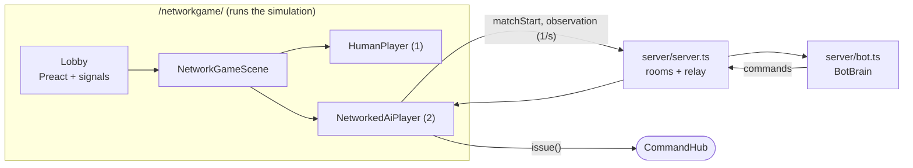

# Network game

Play against a **networked AI**: a separate process that joins over a WebSocket, sees only what player 2 could
fairly see, and sends back ordinary [`Command`](../src/model/command/Command.ts)s.

## Running it

```sh
npm run server      # WebSocket lobby/relay server on ws://localhost:8090 (PORT=… to change)
npm run dev         # Vite on http://localhost:8081, proxies /ws to the server (SLAVIR_WS_PORT=… if moved)
```

Open <http://localhost:8081/networkgame/> (or "Network game" on the homepage or the game's main menu), create a room, click
**Add networked AI**, then **Start match**. "Add networked AI" makes the server start `server/bot.ts` as a
child process; you can also start a bot yourself:

```sh
npm run bot -- <roomId> [--url ws://localhost:8090] [--name "My bot"]
```

`?server=ws://host:port` on the page URL connects to another server than the page's own origin.

## How it fits together



- The **human's browser is authoritative**: it runs the fixed-tick simulation as in a normal match. The server
  only keeps rooms and forwards messages; it never simulates.
- `NetworkedAiPlayer` sends the bot `matchStart` (static [`MatchInfo`](../src/net/Observation.ts)) once, then an
  [`Observation`](../src/net/Observation.ts) every 1000 ms of simulation time, the built-in AI's cadence.
- The bot answers with `{tick, commands}`. They are issued from the WebSocket handler, i.e. between ticks, so the
  hub treats them as **external** input: they take effect on the next tick and the replay recorder stores them.
- Replays of network matches carry `mode: "network"`; playback creates a `NetworkedAiPlayer` without a connection
  and the recorded commands drive it.

## Fairness

The observation is built by [`ObservationBuilder.ts`](../src/model/player/ObservationBuilder.ts) from the
player's own fog of war:

| Sent | Not sent |
|---|---|
| Own state in full: resource, base health, cooldowns, unit cap, buildings, resource patches, powers, every own unit (tile, health, order state, enemies it gave up on) | Enemy resource, cooldowns, production, orders |
| Enemy units in `player.visibleEnemyUnits` right now | Enemy units outside vision |
| Enemy buildings once seen | Unseen enemy buildings |
| What both players see on screen: match time, both base health values, pad control, nuke charge | |
| The map (tiles, pads, both base locations) and the unit / building / power rules | |

The host also enforces it on the way back: every incoming command's `playerIndex` is overwritten with the
networked player's index, batches decided on observations older than 3 s are dropped, and `CommandHub` validates
as for any player (only visible attack targets, costs, cooldowns, own units). `MatchInfo` holds the full unit
prices; `self.unitCosts` in each observation is what recruiting costs right now (a destroyed harvester is
rebuilt for free, `self.freeHarvesters` counts those rebuilds).

## Protocol

JSON text frames, types in [`protocol.ts`](../src/net/protocol.ts). The full reference, with an example payload
for every message and command and what a client has to do with each server message, is
**[network-protocol.md](network-protocol.md)**. In short:

| From | Message | |
|---|---|---|
| client | `hello {role, name, protocol}` | first message; role `human` or `bot` |
| human | `listRooms`, `createRoom {name}`, `joinRoom {roomId}`, `leaveRoom` | lobby |
| bot | `joinRoom {roomId}` | |
| host | `spawnBot` | server starts a bot process for the room |
| host | `startMatch` | needs a bot in the room; everyone gets `matchStarting` |
| host → bot | `matchStart {info}`, `observation {obs}`, `matchEnd {winnerIndex}` | relayed |
| bot → host | `commands {tick, commands}` | relayed |
| server | `welcome`, `rooms`, `roomState`, `matchStarting`, `peerLeft`, `error` | |

The server checks that relay messages come from the right role. When the host leaves, the room closes and any bot
process started for it is stopped. When the bot leaves mid-match the game continues and shows
"Networked AI disconnected"; its units keep auto attacking.

## Writing another bot

Anything that speaks the protocol can play: connect, `hello` as `bot`, `joinRoom`, keep the `matchStart` info and
answer each `observation` with `commands`; [network-protocol.md](network-protocol.md#writing-a-bot-checklist) has
a checklist and a minimal bot. [`BotBrain`](../server/botBrain.ts) is the reference: a port of
`AiPlayer`'s decisions onto the observation. Unlike `AiPlayer` it does not check the turret's line of fire, which
the observation does not carry.
