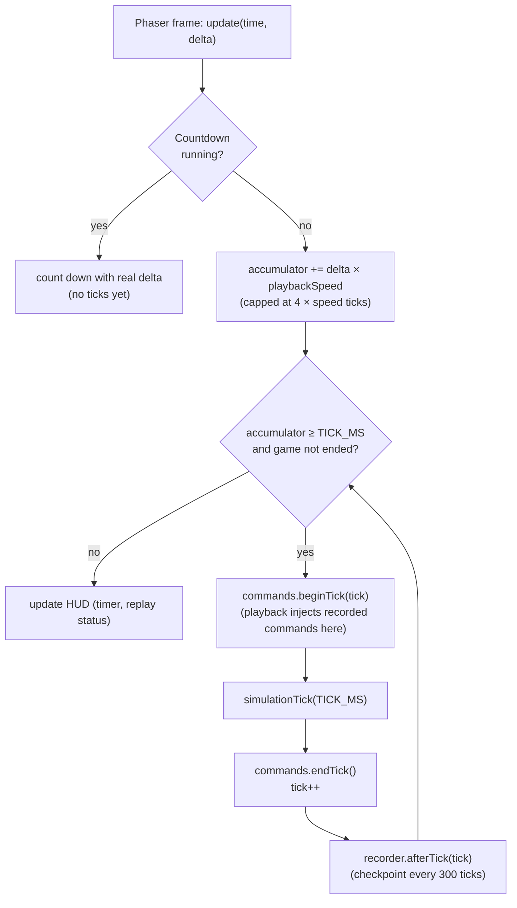
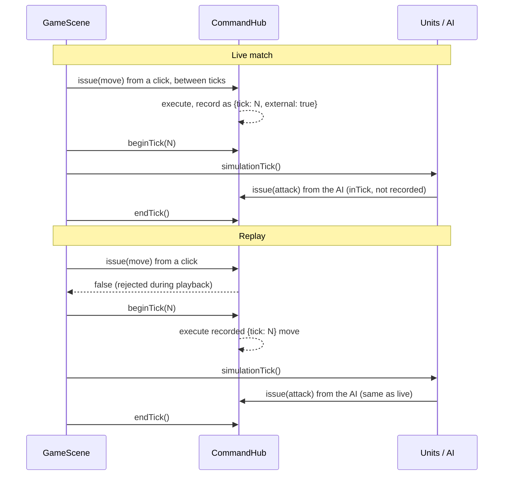

# Replays

A replay is a small JSON file you can save after a match and play back later. It doesn't
store unit positions or video. It stores **the commands the human player gave, and the
simulation tick each one took effect on**. Playing a replay starts a fresh match and
feeds those commands back at the same ticks. Everything else (the AI, auto-attacks,
combat, economy, the objective) comes out the same because the simulation is
**deterministic**.

A 2.5-minute match with about 90 commands takes roughly 9 KB.

- [How to use it](#how-to-use-it)
- [The big idea](#the-big-idea)
- [The fixed-tick simulation](#the-fixed-tick-simulation)
- [How commands are routed](#how-commands-are-routed)
- [Recording](#recording)
- [Playback](#playback)
- [Desync detection](#desync-detection)
- [The file format](#the-file-format)
- [Rules for keeping the game deterministic](#rules-for-keeping-the-game-deterministic)
- [Limitations](#limitations)
- [Debugging recipes](#debugging-recipes)
- [Code map](#code-map)

## How to use it

1. Play a match until it ends (win, lose, or **Retire**).
2. On the score screen, click **Download replay**. You get
   `slavir-replay-<date>_<time>.json`.
3. Later, on any score screen, click **Load replay** and pick the file.

While a replay plays:

- The top of the screen shows **REPLAY**. It turns red and reads
  "out of sync at m:ss" if the playback diverges from the recording (see
  [Desync detection](#desync-detection)).
- The Retire button becomes a **Speed** button that cycles 1x → 2x → 4x → 8x.
- Pause still works. You can select units, but clicks, cards and the F key don't change
  anything.
- When the match ends you land on the score screen again and can download the replay
  you just watched. It is identical to the original.

## The big idea

A match is a function of three things:

```
initial state  +  inputs over time  →  final state
```

The initial state is always the same: same map, both castles and spawns, 100 resources
each. If the step from one moment to the next is also always the same, the inputs are
the only thing worth saving. That's how most RTS games do replays, and it's the same
idea as lockstep networking. A network peer is just a replay that arrives live.

Two things must hold for this to work:

1. **The simulation is deterministic.** Given the same state and inputs it always
   produces the same next state, however fast the computer is or how long a frame
   took.
2. **Every input goes through one door, with a timestamp.** That door is
   `CommandHub.issue()`, and the timestamp is the simulation tick.

The rest of this document explains how each is guaranteed.

## The fixed-tick simulation

Phaser calls `GameScene.update(time, delta)` once per rendered frame, and `delta`
changes every frame (16.7 ms at 60 Hz, 6.9 ms at 144 Hz, hundreds of ms when the tab
is in the background). If game logic used `delta` directly, the same match would play
out slightly differently on every machine.

So `update` doesn't run game logic. It **accumulates** real time and runs fixed-size
**ticks** of `TICK_MS = 1000 / 60` ms:



A slow frame runs several ticks, and a fast frame may run none. The cap
(`MAX_TICKS_PER_FRAME`) keeps a long stall from freezing the game while it catches up.
The skipped time is dropped. That changes how fast the match plays in real time, never
its outcome.

`simulationTick(delta)` always receives exactly `TICK_MS` and does this, in this order:

| Step                                               | What happens                                                                  |
| -------------------------------------------------- | ----------------------------------------------------------------------------- |
| `physics.world.singleStep()`                       | Arcade physics moves every body by one 60 fps step and syncs sprite positions |
| `drawVisibleTiles()`                               | Fog of war: recomputes each player's `visibleEnemyUnits` and fades tiles      |
| `unit.update(delta)` for player 1, then player 2   | Movement, targeting, auto-attack, firing, death countdown                     |
| `commands.update(delta)`                           | Steps active orders and drops finished ones                                   |
| `resource.update(delta)`                           | Crystal depletion                                                             |
| `objective.update(delta)`                          | Pad control, rocket countdown and strike                                      |
| `player.update(delta)` for player 1, then player 2 | Income, production cooldown. The AI decides here.                             |
| Base health check                                  | Calls `endGame()` if a castle is destroyed                                    |

Physics is stepped by hand: `create()` calls `physics.disableUpdate()`, so arcade physics
no longer advances once per rendered frame on its own. `singleStep()` advances it by
exactly one physics frame, which matches `TICK_MS`.

> The three-second countdown still uses real time. Tick 0 is the first tick after the
> countdown, in both a live match and a replay.

## How commands are routed

Commands come from three kinds of places:

| Source             | Example                                                   | When it happens                         | Recorded? |
| ------------------ | --------------------------------------------------------- | --------------------------------------- | --------- |
| **External input** | Clicking the map, a unit card, a building card, F, Retire | Between ticks (DOM/Phaser input events) | **Yes**   |
| **AI**             | `AiPlayer.play()` builds, produces, sends units to pads   | Inside a tick (`player.update`)         | No        |
| **Simulation**     | A unit auto-attacks an enemy in range                     | Inside a tick (`unit.update`)           | No        |

The AI and auto-attacks only read simulation state, and they run inside the tick, so
the same state produces the same commands. They don't need saving: in a replay they
happen again on their own. Only external input is information that can't be derived,
so only external input is recorded.

`CommandHub` tells these apart with the tick brackets the scene puts around every tick:

```ts
commands.beginTick(tick); // inTick = true
simulationTick(TICK_MS); // AI and auto-attacks issue commands here
commands.endTick(); // inTick = false, tick++
```

A command issued while `inTick` is false comes from outside the simulation. It counts as
**external** and is stamped with the hub's current `tick`, which between ticks is the
**next tick to run**. That stamp is accurate: a command executed between tick N-1 and
tick N has the same effect as one executed at the very start of tick N, before the
physics step.

Every accepted command is passed to the `onCommand` listeners together with
`{tick, external}`:

```ts
systems.commands.onCommand((command, {tick, external}) => { ... });
```

### Commands are data

A command never holds a reference to an object. It refers to units by `Unit.id` and to
tiles by tilemap `{col, row}`, so it serializes to JSON as-is (see
[Command.ts](../src/model/command/Command.ts)):

```json
{ "kind": "move", "playerIndex": 1, "unitIds": [7], "tile": { "col": 12, "row": 5 } }
```

Unit ids come from `Systems.nextUnitId()`, a counter that restarts at 1 every match.
Units are created in the same order in a replay, so id 7 is the same unit both times.

The kinds are `move`, `attack`, `stop`, `disband`, `build`, `createUnit` and
`surrender`. **Retire** sends `surrender` instead of calling `endGame()` directly, so a
replay also knows when and how the match ended.

## Recording

Every match records itself, whether you play it or watch it.
[`ReplayRecorder`](../src/model/replay/Replay.ts) is created in `GameScene.create()` and
does two things:

- It subscribes to `onCommand` and stores `{tick, command}` for every **external**
  command (it stores a `structuredClone` of the command, so later changes to the object
  can't affect the recording).
- After every tick, `afterTick(tick)` stores a **checkpoint** (a hash of the game
  state) whenever `tick % CHECKPOINT_INTERVAL === 0`. With an interval of 300 that's
  every 5 seconds of game time.

When the match ends, `endGame()` notes `endTick = this.tick`. Three seconds later it
calls `recorder.finish(endTick, result)` and passes the replay to the score screen. The
delay matters: a `surrender` command ends the game _while it is being issued_, and the
recorder only stores it after `issue()` returns. Finishing later makes sure the
surrender is in the file.

## Playback

`ScoreScene` → **Load replay** → `pickReplayFile()` → `parseReplay()` →
`scene.start(GAME, {replay})`.

`GameScene.create({replay})` builds a normal match, then:

```ts
this.systems.commands.startPlayback(replay.commands);
```

From then on the hub behaves differently:

- **External input is rejected.** `issue()` returns `false` for any command issued
  outside a tick, so the player's clicks have no effect.
- **Recorded commands are executed in `beginTick(tick)`.** Before anything else in a
  tick, the hub runs every recorded command whose `tick` has been reached. That's the
  same point where the original command took effect.
- **AI and simulation commands are still accepted.** They happen inside the tick, so the
  AI plays exactly as it did in the original match.



If a recorded command is rejected during playback (for example, the unit it refers to
is already dead), the hub logs `Replay command rejected at tick …` to the console. That
can only happen once the replay has already diverged.

**Playback speed** multiplies the real time fed to the accumulator, so 4x runs four
times as many ticks per frame. The ticks themselves are unchanged, so speed never
affects the outcome.

## Desync detection

If the code changed between recording and playback, or something nondeterministic
slipped in, the replay drifts from the original. Often it drifts quietly at first: a
unit stops one hex further away, and a minute later the fight goes the other way.
Checkpoints catch that early.

`stateHash(systems)` builds a string from the state that decides the outcome and hashes
it with 32-bit FNV-1a:

- for each player: index, resources, base health, production cooldown
- for each unit: id, position (rounded to 0.01 px), health, whether it is dying
- the objective's cooldown

During playback, `ReplayVerifier` computes the same hash at every checkpoint tick and
compares it with the stored one. On the first mismatch it:

- sets `desyncTick`,
- logs `Replay desync at tick … expected …, got …` to the console,
- and the HUD shows **REPLAY - out of sync at m:ss** in red.

The replay keeps playing after a desync. It just no longer matches what happened.

## The file format

```json
{
    "format": "slavir-replay",
    "version": 1,
    "tickMs": 16.666666666666668,
    "recordedAt": "2026-11-21T20:21:16.512Z",
    "endTick": 8830,
    "result": false,
    "commands": [
        { "tick": 0, "command": { "kind": "build", "playerIndex": 1, "building": "barrack" } },
        { "tick": 97, "command": { "kind": "createUnit", "playerIndex": 1, "unit": "fantasy8" } },
        { "tick": 211, "command": { "kind": "move", "playerIndex": 1, "unitIds": [3], "tile": { "col": 9, "row": 6 } } },
        { "tick": 8830, "command": { "kind": "surrender", "playerIndex": 1 } }
    ],
    "checkpoints": [{ "tick": 300, "hash": "9c1e04a7" }, { "tick": 600, "hash": "51f3bb20" }]
}
```

(Shortened: a real file lists every command and a checkpoint every 300 ticks.)

| Field               | Meaning                                                                                                |
| ------------------- | ------------------------------------------------------------------------------------------------------ |
| `format`, `version` | Identify the file. `parseReplay` rejects anything else. Bump `REPLAY_VERSION` when the format changes. |
| `tickMs`            | Tick length it was recorded with. It must equal `TICK_MS`.                                             |
| `recordedAt`        | ISO timestamp. Only used for the download filename.                                                    |
| `endTick`           | Tick count when the match ended.                                                                       |
| `result`            | `true` if player 1 won, `false` if they lost, `null` if unfinished.                                    |
| `commands`          | External commands in tick order. `tick` is the tick at whose start the command runs.                   |
| `checkpoints`       | State hashes; `tick` is the number of ticks completed at that point.                                   |

`parseReplay` checks the format, version, tick length and the shape of every command,
and sorts `commands` by tick. A file that fails any check shows "Could not load replay:
…" on the score screen.

## Rules for keeping the game deterministic

These rules apply to **all game code**, not only the replay code. Breaking one won't
cause an error. It shows up later as a replay that goes out of sync.

**Change game state only inside `simulationTick`, and only with its `delta`.**
That covers health, positions, targets, resources, cooldowns and timers. Input handlers,
tweens, the scene clock and animation callbacks may _issue commands_ or change _visuals_,
nothing else.

| Don't                                                      | Do instead                                                                                                           |
| ---------------------------------------------------------- | -------------------------------------------------------------------------------------------------------------------- |
| `scene.time.delayedCall(ms, …)` for gameplay               | Count a field down by `delta` in an `update(delta)` (see `Objective.updateStrike`)                                   |
| React to `animationcomplete` for gameplay                  | Time it in game time (see `Unit.updateDeath`). Animation events are fine for visuals.                                |
| `async` / `await` / `.then()` in game logic                | Plain callbacks. Promises resolve after the frame, and a frame can hold several ticks.                               |
| `Math.random()` in game logic                              | A seeded RNG that is part of the match state (none needed yet). Random is fine for visual effects (see `Shockwave`). |
| `Date.now()`, `performance.now()`, frame `time`            | The tick count or accumulated `delta`                                                                                |
| Changing game state from a click handler                   | Issue a command through `systems.commands.issue()`                                                                   |
| Iterating `player.units` while units may remove themselves | Iterate a copy: `[...player.units]`                                                                                  |
| Adding a new kind of player input                          | Add a `Command` kind and handle it in `CommandHub`                                                                   |

Iteration order of `Map`, `Set` and arrays, and stable `Array.sort`, are deterministic
in JavaScript, so those are safe.

**Adding a new command kind:**

1. Add an interface to [Command.ts](../src/model/command/Command.ts) and include it in
   the `Command` union. Use ids and tile refs only.
2. Handle it in `CommandHub.issue()`. Return `false` when it's invalid.
3. Issue it from the input handler instead of changing state directly.
4. Old replays keep working as long as existing kinds keep their meaning.

## Limitations

- **Replays are tied to the game version.** Any change to unit stats, AI, pathfinding,
  timings or the map changes how the same commands play out, and the checkpoints will
  report a desync. The file has no game version yet. Storing the build or commit hash in
  it would let the score screen warn before playing.
- **Possibly tied to the browser engine.** Arcade physics uses `Math.atan2`, `Math.cos`
  and `Math.sin`, which can differ in the last bit between JavaScript engines. A replay
  recorded in Chrome is not guaranteed to match in Firefox or Safari.
- **No seeking.** To jump to minute 3 you have to simulate minutes 0–3. At 8x that takes
  about 22 seconds.
- **The death animation can be cut short.** A dying unit is removed after the animation's
  length in game time. At high playback speed, or on a slow frame, the sprite can
  disappear a few frames early. That's visual only.
- **Only player 1 is recorded.** Only player 1's input is recorded, because player 2 is the
  deterministic AI. In a human-vs-human network game, player 2's commands would come in
  as external input too, and the recorder would store them the same way.

## Debugging recipes

Run these in the browser console during a match. `window.game` is the `GameScene`.

```js
// Current tick and the state hash right now
game.tick;
(await import("/model/replay/Replay.ts")).stateHash(game.systems);

// Is a replay running, and has it diverged?
!!game.replay;
game.verifier?.desyncTick; // null while in sync

// Replay of the match that just ended (on the score screen)
game.game.scene.getScene("ScoreScene").sys.settings.data.replay;
```

To check a new feature, record a match that uses it, replay it, and compare the
checkpoints:

```js
const a = game.game.scene.getScene("ScoreScene").sys.settings.data.replay;
game.game.scene.getScene("ScoreScene").scene.start("GameScene", {replay: a});
// ...let it finish (8x speed helps), then on the new score screen:
const b = game.game.scene.getScene("ScoreScene").sys.settings.data.replay;
JSON.stringify(a.checkpoints) === JSON.stringify(b.checkpoints); // must be true
```

If they differ, the first mismatching checkpoint brackets the problem to a 5-second
window. Lowering `CHECKPOINT_INTERVAL` narrows it down further. Look for gameplay code
in that window that breaks one of the [rules](#rules-for-keeping-the-game-deterministic).

> The `import("/model/replay/Replay.ts")` path works with `npm run dev`, which serves
> the `src` folder as the site root.

## Code map

| File                                                                  | Role                                                                                                                     |
| --------------------------------------------------------------------- | ------------------------------------------------------------------------------------------------------------------------ |
| [src/model/replay/Replay.ts](../src/model/replay/Replay.ts)           | `TICK_MS`, file format, `ReplayRecorder`, `ReplayVerifier`, `stateHash`, `parseReplay`, download and file-picker helpers |
| [src/model/command/CommandHub.ts](../src/model/command/CommandHub.ts) | Single entry point for commands. `beginTick`/`endTick`, external vs derived, `startPlayback`, `onCommand`                |
| [src/model/command/Command.ts](../src/model/command/Command.ts)       | The serializable command types                                                                                           |
| [src/scenes/GameScene.ts](../src/scenes/GameScene.ts)                 | Fixed-tick loop (`update` → `simulationTick`), manual physics stepping, recording, verification, replay HUD and speed    |
| [src/scenes/ScoreScene.ts](../src/scenes/ScoreScene.ts)               | **Download replay** and **Load replay** buttons                                                                          |
| [src/entities/Unit.ts](../src/entities/Unit.ts)                       | `prepForDestroy` / `updateDeath`: unit removal timed in game time                                                        |
| [src/entities/Objective.ts](../src/entities/Objective.ts)             | `launchStrike` / `updateStrike`: rocket timed in game time                                                               |
| [src/model/player/Player.ts](../src/model/player/Player.ts)           | Synchronous `freeHandler` and the `onUnitRemoved` hook                                                                   |
